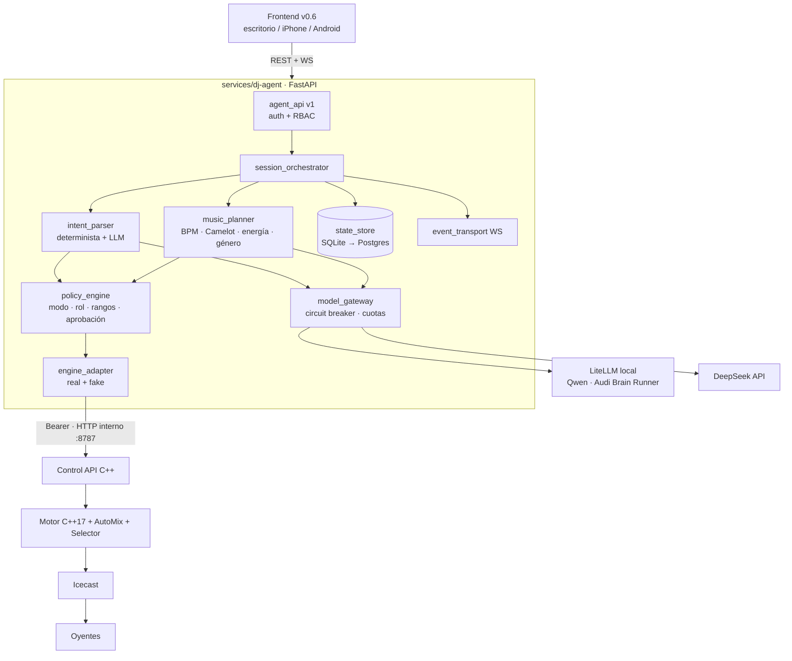

# 01 · Arquitectura objetivo — Agente DJ (propuesta Fase 0, pendiente de aprobación)

## 1. Diagrama



El agente **nunca toca PCM** (P‑01): planifica y emite comandos validados; el motor y el AutoMix
garantizan la continuidad aunque el agente, el LLM o el móvil caigan.

## 2. Decisiones (ADR)

| ADR | Decisión | Motivo / alternativa descartada |
|---|---|---|
| ADR‑001 | Servicio nuevo `services/dj-agent/` en **Python 3.12 + FastAPI + Pydantic v2**, `pytest`, `ruff`, `mypy` | Disponible y probado en el ecosistema (Audi Brain Runner); el repo no tiene backend Python que reutilizar. Descartado: extender la Control API C++ con lógica de IA (riesgo para el hilo de audio). |
| ADR‑002 | Persistencia con **SQLAlchemy 2 + SQLite** (archivo en volumen) por defecto; Postgres opcional por `DATABASE_URL` | No exige contratar infraestructura (P‑07/§8.10). Postgres solo con aprobación. |
| ADR‑003 | **Sin Redis ni cola externa** en v1: scheduler `asyncio` en proceso + persistencia del plan | Una instancia; menor superficie. Se reevalúa si se escala. |
| ADR‑004 | **Autoridad única por sesión**: una sesión del agente gobierna el **motor del servidor**; mientras exista, el v0.6 manda sus controles por la API del agente y el motor WASM del navegador queda desactivado para esa sesión | Evita dos fuentes de audio (P‑03). El modo WASM queda para práctica/preparación local. **Requiere tu confirmación.** |
| ADR‑005 | El agente usa una **cuenta de servicio** de la Control API. Propiedad del control por modo: MANUAL → humano; HÍBRIDO → humano con propuestas; AUTOMÁTICO → agente | Resuelve B4 sin cambiar el modelo de handoff del motor. |
| ADR‑006 | Extensiones **mínimas** del motor (B1, B2): metadatos en `/api/tracks` y cola del agente consumida por `nextTrackCb` con caída al `Selector` | Reutiliza análisis existente; no toca el hilo de audio (solo el callback de "siguiente pista"). |
| ADR‑007 | `model_gateway` habla **OpenAI‑compatible** con LiteLLM local y DeepSeek, con las **mismas variables** que el runner (`LOCAL_LLM_*`, `DEEPSEEK_*`) | Protocolo ya probado; no se depende del proceso del runner. |
| ADR‑008 | `intent_parser` **determinista primero**; el LLM solo cuando la regla no alcanza; salida JSON validada con Pydantic | Coste ~0 y latencia baja para órdenes frecuentes; el LLM no es requisito para operar. |
| ADR‑009 | El modelo **solo devuelve intenciones/planes con IDs de pistas del catálogo**; toda pista se verifica contra el catálogo antes de proponerse | Cero títulos inventados (§4.3). |

## 3. Módulos (estructura prevista)

```
services/dj-agent/
  app/main.py
  app/api/v1/{sessions,commands,plans,agent,health,events}.py
  app/core/{settings,security,logging,errors}.py
  app/domain/{models,commands,events,policies}.py
  app/orchestration/{session_manager,planner,model_router}.py
  app/adapters/{engine_api,engine_fake,catalog,llm_local,llm_deepseek,persistence}.py
  app/workers/{scheduler,recovery}.py
  tests/{unit,integration,contract,failover,e2e}/
  pyproject.toml · Dockerfile · .env.example (solo nombres) · README.md
```

## 4. Esquema de persistencia (v1)

| Tabla | Campos clave |
|---|---|
| `sessions` | `id`, `org_id`, `owner_id`, `mode` (MANUAL/HIBRIDO/AUTOMATICO), `state` (CREATED…FAILED), `agent_state` (AVAILABLE/DEGRADED/OFFLINE), `version`, `last_sequence`, timestamps |
| `plans` | `id`, `session_id`, `version`, `status` (DRAFT/PROPOSED/APPROVED/ACTIVE/SUPERSEDED), `source` (rules/qwen/deepseek), `constraints_json`, `created_by` |
| `plan_items` | `plan_id`, `position`, `track_ref` (índice/ID verificado), `bpm`, `key`, `energy`, `transition_json`, `confidence` |
| `proposals` | `id`, `session_id`, `kind`, `payload_json`, `requires_approval`, `status`, `decided_by`, `decided_at` |
| `commands` | `id`, `idempotency_key` (único), `session_id`, `actor_id`, `action`, `params_json`, `expected_version`, `status` (PROPOSED/ACCEPTED/SENT/ACKNOWLEDGED/REJECTED/FAILED), `error_code`, `engine_response` |
| `events` | `session_id`, `sequence`, `type`, `payload_json`, `correlation_id`, `source` (replay acotado para reconexión) |
| `preferences` | `scope` (user/org/event), `scope_id`, `key`, `value_json`, `version`, `consent` |
| `llm_usage` | `session_id`, `org_id`, `provider`, `model`, `tokens_in/out`, `cost_estimated`, `latency_ms`, `outcome` |

## 5. Riesgos principales

| Riesgo | Prob. | Impacto | Mitigación |
|---|---|---|---|
| Qwen no cabe/latencia alta en 16 GB compartidos | media | medio | parser determinista + DeepSeek con presupuesto; el audio no depende del LLM |
| Extensión C++ (B2) introduce silencio | baja | alto | cambio solo en el callback de siguiente pista; caída al Selector; soak ≥4 h antes de aprobar |
| Dos fuentes de audio (WASM + servidor) | media | alto | ADR‑004 (autoridad única por sesión) |
| Prompt injection en títulos/metadatos | media | medio | metadatos tratados como datos; allowlist de herramientas; validación de IDs |
| Coste DeepSeek sin control | baja | medio | cuotas por hora/sesión/org + circuit breaker |
| Motor servidor no desplegado en Coolify | **desconocido** | alto | verificar antes de F7; todo F1–F6 se prueba en entorno aislado |

## 6. Fases e hitos (estimación orientativa, no compromiso)

| Fase | Entregable | Depende de | Estimación |
|---|---|---|---|
| F1 | Servicio, contratos, estados, RBAC, idempotencia, **motor fake**, simulador, OpenAPI | — (sin credenciales) | 2–3 días |
| F2 | `engine_adapter` real + extensiones B1/B2 + cambio de modo sin reinicio + fallback AutoMix | motor compilado localmente | 3–4 días |
| F3 | Qwen vía LiteLLM + router + 30+ casos en español | acceso a `LOCAL_LLM_*` desde el entorno de desarrollo | 2 días |
| F4 | DeepSeek + planificador + cuotas/costes | `DEEPSEEK_API_KEY` de desarrollo | 3–4 días |
| F5 | Cableado v0.6 (panel, modos, aprobaciones, eventos) | F1–F2 | 2–3 días |
| F6 | Voz y móvil | dispositivos físicos (tú) | 3 días + pruebas físicas |
| F7 | Endurecimiento, soak 4 h (luego 8–12 h), runbook, candidato de despliegue | F1–F6 + autorización | 3–5 días |

Puerta por fase: código + diff + pruebas ejecutadas + logs + trazabilidad + dictamen QA.
