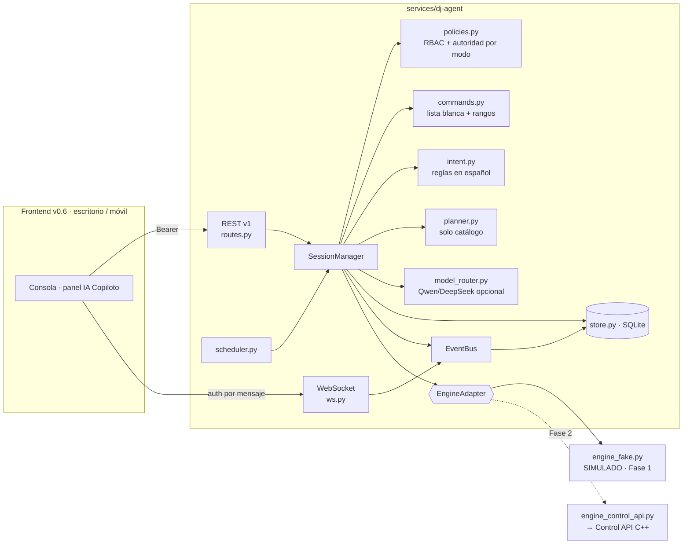
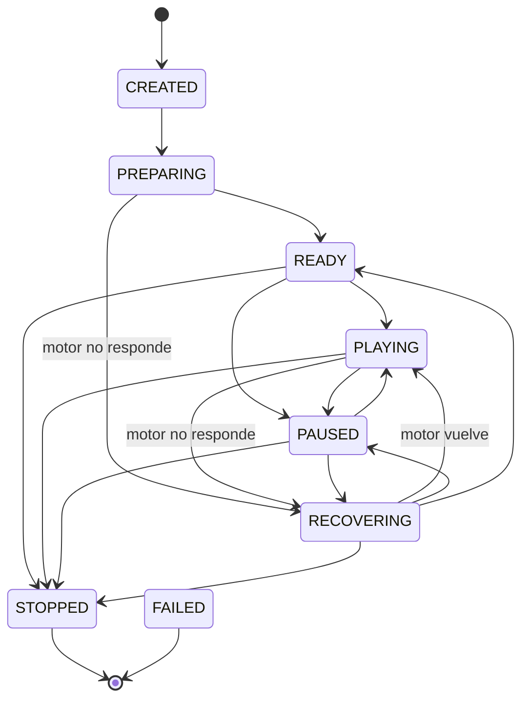

# 05 · Estados y políticas del agente (Fase 1, implementado)

Todo lo descrito aquí está en el código de `services/dj-agent/` y cubierto por pruebas
(referencias entre corchetes).

## 1. Componentes

## 2. Máquina de estados de la sesión

- El estado se **deriva del motor** (fuente de verdad): alguien suena → PLAYING; cargado y detenido → PAUSED;
  motor inalcanzable → RECOVERING. Una caída de la IA **nunca** cambia este estado.
- `agent_state` es independiente: AVAILABLE / DEGRADED (todos los modelos configurados con el circuito abierto).
- `audio_authority: "server"`: **una sola sesión activa por motor** (`engine_busy`), lo que impide dos fuentes
  gobernando el audio a la vez [test_una_sola_sesion_activa_por_motor_evita_dos_fuentes].
- Transiciones inválidas → error 500 `invalid_state_transition` [test_maquina_de_estados…].

## 3. Modos y autoridad del agente

| Modo | Motor (`set_mode_dj`) | Qué puede hacer el AGENTE | Humano |
|---|---|---|---|
| MANUAL | `manual` | Solo observar; muestra planes como sugerencia; **no ejecuta** | Ejecuta todo (con el control) |
| HÍBRIDO | `auto` | Crea **propuestas**; ejecuta sin aprobación solo lo de `hybrid_auto_actions` y si `approval_required=false` | Aprueba / rechaza / ejecuta |
| AUTOMÁTICO | `auto` | Ejecuta dentro de su **nivel de autonomía**; lo demás pasa a propuesta | Puede intervenir siempre |

- **Peligrosas** (`deck_pause`, `deck_cue`, `deck_load`): si las pide el agente, siempre requieren aprobación humana.
  El agente nunca carga platos directamente (usa la cola). Cargar sobre el plato **al aire** exige además
  `confirm=true` incluso a un humano (`409 on_air_deck`).
- Cambiar entre HÍBRIDO y AUTOMÁTICO **no llama al motor**; con MANUAL se llama `set_mode_dj` una vez. Nunca se
  recarga ni se detiene el plato al aire [test_treinta_cambios_de_modo_sin_reinicio_ni_corte].
- Pasar a MANUAL caduca las propuestas pendientes. Cerrar la sesión deja el motor sonando y, con la regla
  «AutoMix de respaldo», lo devuelve a `auto`.

Niveles de autonomía (AUTOMÁTICO):

| Autonomía | Acciones sin aprobación |
|---|---|
| 0–33 | `queue_set`, `queue_clear` (mantener la cola) |
| 34–66 | + `skip`, `set_transition`, `set_mixmode` |
| 67–100 | + `xfader`, `eq`, `filter`, `gain`, `rate`, `deck_play` |

Límite adicional: `max_skips_per_hour` (12 por defecto); al superarlo, el salto pasa a propuesta.

## 4. Roles y permisos (RBAC, servidor)

| Permiso | admin | operator | supervisor | listener |
|---|:-:|:-:|:-:|:-:|
| session:read / events:subscribe | ✔ | ✔ | ✔ | ✔ |
| session:create / close / mode | ✔ | ✔ | — | — |
| command:execute | ✔ | ✔ | — | — |
| control:take | ✔ | ✔ | — | — |
| control:force | ✔ | — | — | — |
| intent:submit / plan:request / proposal:decide | ✔ | ✔ | ✔ | — |
| preferences:read | ✔ | ✔ | ✔ | — |
| preferences:write | ✔ | ✔ | — | — |
| usage:read / audit:read | ✔ | — | ✔ | — |

El rol `agent` es la identidad interna del agente y **no se puede autenticar por HTTP**. Las sesiones de otra
organización responden 404 (no se revela su existencia).

## 5. Varios operadores: lease de control

- Un único **controlador** por sesión, con caducidad (`DJ_AGENT_LEASE_SECONDS`, 120 s). Quien crea la sesión lo obtiene.
- Toda operación humana que cambia estado exige tener el control; si está libre o caducó, se toma automáticamente.
- Otro operador recibe `409 control_held` y puede `request`; quien controla `approve` o `deny`.
- `take` con `heartbeat=true` renueva el lease. `force` (solo admin) queda auditado como `control.forced`.
- Además, `expected_version` (concurrencia optimista) devuelve `409 version_conflict` si la sesión cambió.

## 6. Ciclo de vida de un comando

`ACCEPTED → SENT → ACKNOWLEDGED | REJECTED | FAILED` (las propuestas usan `PENDING → APPROVED → EXECUTED | FAILED`,
`REJECTED`, `EXPIRED`).

- **ACK real**: tras ejecutar, se relee el estado del motor. `ack_level=state_verified` si el efecto se observa
  (play/pause, crossfader, transición, carga); `engine_ok` si el motor respondió OK pero el efecto no es visible en
  `/status` (EQ, filtro, ganancia, pitch). Si el estado contradice la acción → `FAILED effect_not_observed`.
- **Idempotencia**: `Idempotency-Key` obligatoria en comandos, modo, cierre y decisiones. Misma clave + mismo
  contenido → respuesta guardada con `idempotent_replay: true` (sin reenviar al motor, también si había fallado);
  misma clave + otro contenido → `409 idempotency_conflict`; en curso → `409 request_in_progress`. Un error de
  validación libera la clave.
- **Recuperación tras reinicio del agente**: comandos `SENT` se verifican contra el motor (ACK recuperado o
  `FAILED unknown_outcome_after_restart`); `ACCEPTED` → `REJECTED not_sent_before_restart`. **Nunca se reenvían.**

## 7. WebSocket `/api/v1/dj-agent/sessions/{id}/events`

1. Primer mensaje (≤5 s): `{"type":"auth","token":"…","after":N}` — el token no viaja en la URL.
2. Respuesta `session.snapshot` con el estado autoritativo y `sequence`.
3. Si `after < sequence`: replay de lo perdido (máx. `DJ_AGENT_WS_REPLAY_LIMIT`; si se trunca, `replay_truncated`).
4. Eventos en vivo, sin duplicados (se descartan secuencias ya enviadas); cola llena → `resync_required`.
5. `{"type":"ping"}` → `{"type":"pong"}`. Cierres: 4401 sin autenticar · 4403 sin permiso · 4404 sesión inexistente u otra organización.

Esquema de evento: `{event_id, sequence, session_id, timestamp, type, payload, correlation_id, source, status, actor_id}`.

Tipos emitidos: `session.created`, `session.state.changed`, `session.closed`, `session.recovered`, `mode.changed`,
`track.changed`, `control.taken|released|requested|transferred|denied|forced`, `command.accepted`,
`agent.command.ack`, `command.rejected`, `command.failed`, `agent.intent.parsed`, `agent.proposal.created|decided|expired`,
`agent.action.blocked`, `plan.created`, `queue.updated`, `preferences.updated`, `agent.autonomous.replan|error`,
`agent.degraded|available`, `engine.mode.error`.

Los mismos eventos se consultan por REST (`GET …/events?after=N`) para auditoría.

## 8. Control del motor real por el agente (Fase 2)

- El agente entra a la Control API C++ como **cuenta de servicio** (`DJ_AGENT_ENGINE_USER/PASS`) y, tras el login,
  intenta `control/take`. El motor solo lo concede si el control está **libre**; nunca se arrebata a otro dispositivo vivo.
- El **token** de esa sesión se guarda en la base del agente (tabla `kv`): si el agente se cae y vuelve, reanuda la
  **misma** sesión y conserva el control. En un apagado ordenado hace `logout` y libera el control. El audio no se
  detiene en ningún caso.
- Si un comando recibe `409 control_held`, el agente reintenta `control/take` **una vez** (prospera solo si el control
  quedó libre) y, si no, informa el comando como `FAILED control_held`.
- Capacidades **detectadas** en el motor: `metadata` (BPM/tono/energía/duración en `/api/tracks`) y `queue` (cola del
  agente). Frente a un motor antiguo el agente se degrada solo: planes sin filtro de compatibilidad y sin cola.
- La cola del agente entra en la siguiente carga libre del AutoMix (como mucho una pista después de la precargada);
  vacía, decide el Selector del motor exactamente como antes.
