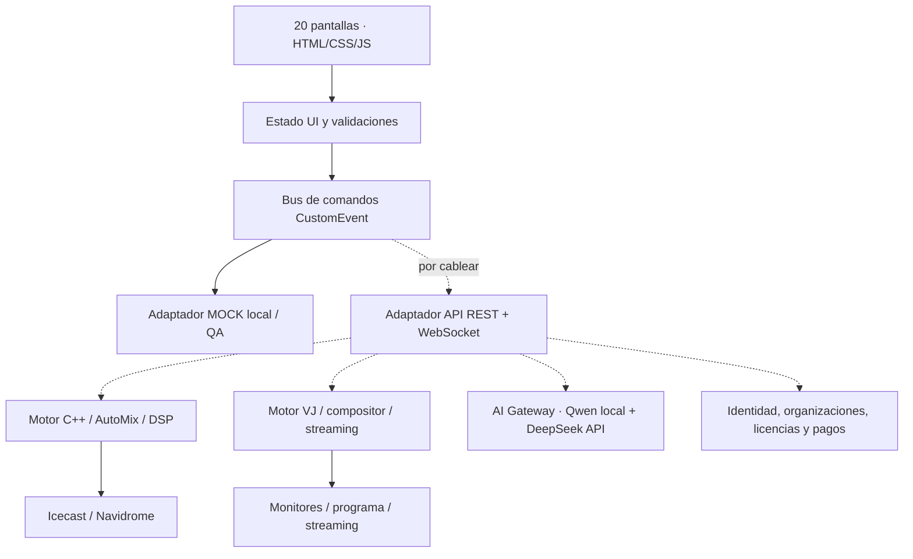

# Arquitectura del frontend — AUDIT SOUND v0.6

## Decisiones de diseño

**Separación de preocupaciones:** la aplicación expone comandos semánticos y estado UI. No toma decisiones musicales ni suplantará al motor DSP. Los controles locales Web Audio y HTML Video permiten probar el frontend sin servicios externos. Las funciones aún simuladas están identificadas visualmente.



### Fuente del código

- `src/modules/01-core-console.js`: metadatos de 20 rutas, estado, renderizado consola, contrato de comandos, eventos.
- `src/modules/02-screens.js`: 20 funciones de pantalla y componentes reutilizables para formulario, sliders y paneles.
- `src/modules/03-actions-audio-video.js`: despachador `act()`, importación y reproducción local, grafo Web Audio, programa de video y acciones de UI.
- `src/modules/04-events-forms.js`: `changeControl`, `onSubmit`, eventos DOM, validación y diagnóstico.
- `src/app.js`: build concatenado de los cuatro módulos en un ámbito compartido. Se genera automáticamente; no editar directamente.

**Nota de deuda técnica:** se priorizó cero dependencias para cumplir el HTML autónomo comprobable. Aunque el código fuente está separado por responsabilidades, utiliza un ámbito JS compartido, en vez de componentes React independientes. Esta decisión deberá revisarse antes de escalar a un SaaS con varios equipos.

### Ruta de un comando

1. Un `<button>` real emite `data-action` o un `<input>` emite `data-change`.
2. El controlador valida el valor e identifica la operación.
3. Se actualiza el estado de la interfaz y se hace el procesamiento local permitido.
4. `command(name,payload,status)` registra ID de correlación, estado y ruta propuesta.
5. Se emite `window.dispatchEvent(new CustomEvent('auditsound:command', {detail}))`.
6. Claude Code podrá sustituir la ejecución `MOCK` por un adaptador de transporte que devuelva `ack`, `error` y `state.snapshot` del backend.

**Ejemplo escuchador:**

```js
window.addEventListener('auditsound:command', (event) => {
  const {name, payload, correlationId, contract, mode} = event.detail;
  // IMPORTANTE: no transmitir al servidor sin autenticación/autorización,
  // validación de parámetros, idempotencia y confirmación apropiada.
  console.debug({name, payload, correlationId, contract, mode});
});
```

### Estado y fallos

Los controles de música y videos locales son reales. Las órdenes al motor, agentes y SaaS solo registran acciones. Falta la sincronización WebSocket; se recomienda actualización optimista controlada y reconciliación con estado del servidor.

### Audio

`MediaElementAudioSourceNode → lowshelf → peaking → highshelf → Gain → Cross Gain(equal power) → Master → AudioContext.destination` por deck. No hay envío a Icecast ni bus de preescucha separado. Micrófonos no se conectan a AudioContext; deliberadamente se evita realimentación acústica por defecto.

### Video

2 `<video>` fuente independientes; la vista de programa local crea dos videos silenciados en capas y ajusta opacidad CSS. No constituye una mezcla de cuadros sincronizada ni un stream codificado. No debe anunciarse un motor VJ profesional antes del servicio correspondiente.

### IA

Panel del agente con selección Qwen/DeepSeek, autonomía, política de aprobación e historial. El texto del usuario queda local, sin inferencia. Un AI Gateway real deberá validar comandos permitidos, latencia, presupuesto, fallbacks, permisos y confirmaciones. El motor C++ siempre seguirá autónomo respecto de fallos del modelo.

### Seguridad y comercialización

Login demo no autoriza acciones reales. Roles/usuarios/licencias/planes/facturas son prototipos locales; el backend deberá imponer RBAC y aislamientos por organización, guardar secretos solo en servidor, controlar la facturación y no confiar en datos del cliente.
